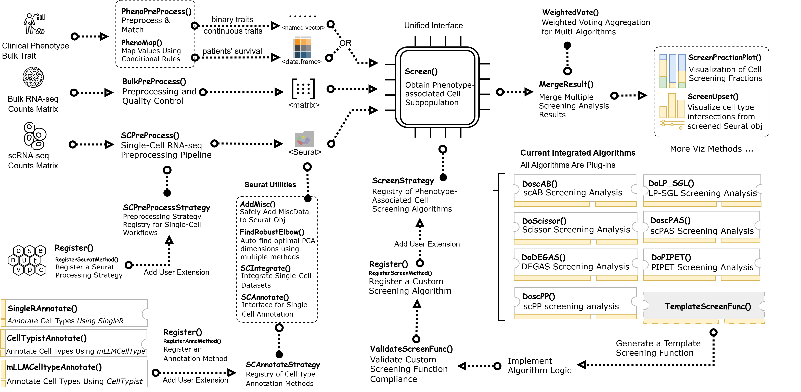

<!-- README.md is generated from README.Rmd. Please edit that file -->

```{r}
#| include: false
knitr::opts_chunk$set(
  collapse = TRUE,
  comment = "#>",
  fig.path = "man/figures/README-",
  out.width = "100%"
)
```

# SigBridgeR <a href="https://wanglabcsu.github.io/SigBridgeR/"></a>

<!-- badges: start -->
[](https://www.repostatus.org/#active)
[](https://lifecycle.r-lib.org/articles/stages.html#stable)
[](https://github.com/WangLabCSU/SigBridgeR)
[](https://github.com/WangLabCSU/SigBridgeR/actions)
[](https://deepwiki.com/WangLabCSU/SigBridgeR)
[](https://app.codecov.io/gh/WangLabCSU/SigBridgeR)
[](https://wanglabcsu.r-universe.dev/)
<!-- badges: end -->


## 🌐 Overview

SigBridgeR integrates multiple algorithms, using single-cell RNA
sequencing data, bulk expression data, and sample-related phenotypic
data, to identify the cells most closely associated with the phenotypic
data, performing as a bridge to existing tools.

<p align="center">



</p>

**Current Status**

|  Algorithm  | Fork Version |       Supported Phenotypes       | Cache Support |  License   |                Note              |  
|:-----------:|:------------:|:--------------------------------:|:-------------:|:----------:|:--------------------------------:|
| **Scissor** |  v2.1.0 | `binary` `survival` `continuous` |       ✅      |   GPL-3    |                                  |
|  **scPAS**  |  v0.2.1 | `binary` `survival` `continuous` |               |   GPL-3    |                                  |
|  **scAB**   |  v1.0.5 | `binary` `survival` `continuous` |       ✅      |   GPL-3    |                                  |
|  **scPP**   |  v0.0.2 | `binary` `survival` `continuous` |               |   GPL-3    |                                  |
|  **DEGAS**  |  v1.0.1 | `binary` `survival` `continuous` |               |    MIT     |                                  |
| **DEGASv2** |  v1.0.0 | `binary` `survival` `continuous` |               |    MIT     | Bulk raw counts matrix perferred |
| **LP-SGL**  |  v0.0.2 | `binary` `survival` `continuous` |               | No License |                                  |
|  **PIPET**  |  v0.1.7 | `binary` `survival` `continuous` |       ✅      |   GPL-3    | Bulk raw counts matrix perferred |
| **SIDISH**  |  v0.0.2 |            `survival`            |               |    MIT     |                                  |
| **SCIPAC**  |  v0.1.1 | `binary` `survival` `continuous` |               |    MIT     |                                  |
| **TiRank**  |  v0.0.1 | `binary` `survival` `continuous` |               |    MIT     |                                  |

## 🔧 Installatation

Usually we recommend installing the latest release from GitHub because
of the latest features and bug fixes.

1.  Install the development version from GitHub:

```{r}
#| label: installation
#| eval: false

# install.packages("pak")
pak::pak("WangLabCSU/SigBridgeR")
```

2.  Install from r-universe:

```{r}
#| label: installation_runiverse
#| eval: false

install.packages("SigBridgeR", repos = "https://wanglabcsu.r-universe.dev")
```

**unnecessary but recommended**:

<details>
<summary>For better performance:</summary>

```{r}
#| label: installation_extra
#| eval: false

pak::pak(
  # faster computation
  "sparseMatrixStats",
  "matrixStats",
  "preprocessCore",
  "tidyr",
  "matrixTests",
  "KernSmooth",
  "cheapr",
  # better gene symbol conversion
  "scCustomize",
  "WGCNA"
)
```

</details>

<details>
<summary>For seamless integration with single-cell RNA-seq data stored in `.h5ad`:</summary>

```{r}
#| label: installation_anndata
#| eval: false

pak::pak("anndata")
# or
pak::pak("anndataR") # both are supported
```

</details>

<details>
<summary>For visualization:</summary>

```{r}
#| label: installation_visualization
#| eval: false

pak::pak(c(
  "ggplot2",
  "randomcoloR", # or RColorBrewer
  "ggupset", # for upset plot
  "patchwork", # for fraction stack plot
  "ggforce", # for pca plot
  "ggVennDiagram" # for venn diagram
))
```

</details>

<details>
<summary>To use the built-in cell annotation methods:</summary>

```{r}
#| label: installation_cell_annotation
#| eval: false

pak::pak(c(
  # SingleR
  "SingleR-inc/SingleR",
  "celldex",
  # mLLMCelltype
  "mLLMCelltype",
  "plyr",
  # CellTypist
  "reticulate",
  "AnnDataR"
))
```

</details>

<details>
<summary>To add custom extension functions to SigBridgeR:</summary>

```{r}
#| label: installation_custom_extension
#| eval: false

pak::pak(c(
  "tictoc",
  "codetools",
  "lintr",
  "rstudioapi"
))
```

</details>

<!-- 
## 🤝 Community

SigBridgeR allows the community developers to integrate new algorithms without modifying the core package. The following community-developed plugins are maintained by their respective authors.

```{r}
#| label: installation_community_plugins
#| eval: false

# Install community plugins via pak:
pak::pak(c(
  # Example: "username/sigbridger-plugin-example"
))
```

| Name           | Author                     | Status | Repo Link |
|:-------------:|:---------------------------:|:------:|:---------:|
| *Coming soon* | Be the first to contribute! |   -    |     -     |

To contribute your own plugin, refer to the
[vignette on extending SigBridgeR](https://wanglabcsu.github.io/SigBridgeR/articles/extending.html).
-->


## 📓 Get Started

```r
library(SigBridgeR)
res <- Screen(
  bulk, # bulk RNA expression data
  seurat_obj,
  pheno, # named vector label/survival time data.frame
  screen_method = "scAB", # Algorithm
  phenotype_class = "binary" # or "survival"/"continuous"
)
```


-   View [Github Webpage](https://wanglabcsu.github.io/SigBridgeR/)
-   Use `?SigBridgeR::function_name` to access the help documents in R.

If you encounter problems, please check:

-   the [Troubleshooting Guide](vignettes/Troubleshooting.md), or
-   the [Github issues](https://github.com/WangLabCSU/SigBridgeR/issues)
    page if you want to file bug reports or feature requests

Let us know if you have ideas to make this project better. Pull requests are welcome!

## 🧩 Agent Skills

SigBridgeR ships a set of [Agent Skills](https://skills.sh/) that teach AI coding
agents how to drive the package correctly. They live in the standalone [`skills/`](skills) folder and are
installable with the [`skills`](https://www.npmjs.com/package/skills) CLI
(Node.js >= 22).

| Skill | What it covers |
|:------|:---------------|
| `sigbridger-quickstart` | Minimal end-to-end run: `LoadRefData()` -> `Screen()` -> `MergeResult()` -> plots |
| `sigbridger-results-plots` | Reading `ScreenMethodResult`, `MergeResult()`, `WeightedVote()`, `ScreenFractionPlot()`, `ScreenUpset()`, `autoplot()` |
| `sigbridger-extend` | Plugging in custom algorithms via `TemplateScreenFunc()`, `ScreenMethod`, `AnnotationMethod` and `Register()` |
| `sigbridger-utilities` | Helper toolkit: `SCIntegrate()`, `ChooseNormalization()`, `SymbolConvert()`, `AddMisc()`, `SCAnnotate()`, `setThreads()` |

Install every skill (interactive: pick the skills and the target agents):

```bash
npx skills add WangLabCSU/SigBridgeR
```

Install one skill non-interactively, into a specific agent:

```bash
npx skills add WangLabCSU/SigBridgeR --skill sigbridger-quickstart -a codebuddy
```

Install globally so the skills are available in every project on the machine:

```bash
npx skills add WangLabCSU/SigBridgeR -g
```

Manage the installed set:

```bash
npx skills list      # what is installed and where
npx skills check     # are updates available
npx skills update    # pull the latest version
npx skills remove    # uninstall
```

## 📚 Citation

If you use SigBridgeR in your work, please cite the corresponding papers:

```{r}
#| label: citation
citation("SigBridgeR")
```


## 🗺️ Similar Projects

[scSurvival](https://github.com/cliffren/scSurvival): Single-cell expression matrix (log-normalized + HVG-selected) + survival data (optional clinical covariates and batch labels) -> Survival-associated cell subpopulations

[CellPhenoX](https://github.com/fanzhanglab/pyCellPhenoX): Single-cell multi-omics data + bulk-level clinical variables, covariates (optional interaction effect terms) -> interpretable score per cell

[scPrognosis](https://github.com/XiaomeiLi1/scPrognosis): scRNA-seq count matrix (imputed by MAGIC + filtered for low coverage/expression) + bulk RNA-seq expression matrix (with matched survival time and event status) -> breast cancer prognostic gene signatures and Cox PH risk prediction model

[SCellBOW](https://github.com/cellsemantics/SCellBOW): source scRNA-seq expression matrix + target scRNA-seq expression matrix + (optional) bulk RNA-seq expression matrix with paired survival data -> cell embeddings, cluster assignments, UMAP visualizations, and phenotype-algebra-derived risk scores with survival probability curves for individual cell subpopulations.

[scPER](https://github.com/BrianLlll/scPER): Single-cell RNA-seq data + bulk RNA-seq data + celltype annotation (optional batch labels) -> phenotype-associated cell populations
