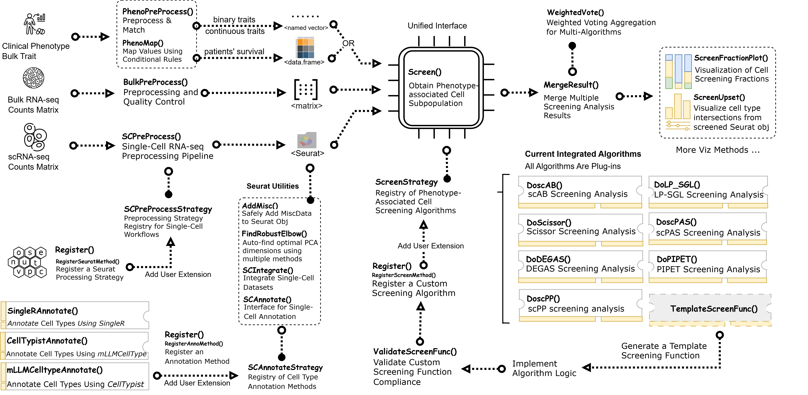

<!-- README.md is generated from README.Rmd. Please edit that file -->

# SigBridgeR <a href="https://wanglabcsu.github.io/SigBridgeR/"></a>

<!-- badges: start -->

[](https://lifecycle.r-lib.org/articles/stages.html#experimental) [](https://github.com/WangLabCSU/SigBridgeR) [](https://lifecycle.r-lib.org/articles/stages.html#stable) [](https://github.com/WangLabCSU/SigBridgeR/tree/version3) [](https://github.com/WangLabCSU/SigBridgeR/actions) [](https://deepwiki.com/WangLabCSU/SigBridgeR) [](https://app.codecov.io/gh/WangLabCSU/SigBridgeR) [](https://wanglabcsu.r-universe.dev/) <!-- badges: end -->

## 🌐 Overview

SigBridgeR integrates multiple algorithms, using single-cell RNA sequencing data, bulk expression data, and sample-related phenotypic data, to identify the cells most closely associated with the phenotypic data, performing as a bridge to existing tools.

<p align="center">



</p>

**Current Status**

| Algorithm | Supported Phenotypes | Cache Support | License | Note |
|:--:|:--:|:--:|:--:|:--:|
| [**Scissor**](https://github.com/sunduanchen/Scissor) | `binary` `survival` `continuous` | ✅ | GPL-3 |  |
| [**scPAS**](https://github.com/aiminXie/scPAS) | `binary` `survival` `continuous` |  | GPL-3 |  |
| [**scAB**](https://github.com/jinworks/scAB) | `binary` `survival` `continuous` | ✅ | GPL-3 |  |
| [**scPP**](https://github.com/WangX-Lab/ScPP) | `binary` `survival` `continuous` | ✅ | GPL-3 |  |
| [**DEGAS**](https://github.com/tsteelejohnson91/DEGAS) | `binary` `survival` `continuous` |  | MIT |  |
| [**DEGASv2**](https://github.com/ElliotLiu1997/DEGASv2) | `binary` `survival` `continuous` |  | MIT | Bulk raw counts matrix perferred |
| [**LP-SGL**](https://github.com/hongmeizhanghm/LP_SGL) | `binary` `survival` `continuous` |  | No License |  |
| [**PIPET**](https://github.com/ruan2ruan/PIPET) | `binary` `survival` `continuous` | ✅ | GPL-3 | Bulk raw counts matrix perferred |
| [**SIDISH**](mcgilldinglab/SIDISH) | `survival` |  | MIT\* / PolyForm NC 1.0.0 | see [note]((#special-declaration-concerning-sidish)) below |
| [**SCIPAC**](https://github.com/mianaz/SCIPAC) | `binary` `survival` `continuous` |  | MIT |  |
| [**TiRank**](https://github.com/LenisLin/TiRank) | `binary` `survival` `continuous` | ✅ | MIT |  |
| [**PhenoMapR**](https://github.com/brooksbenard/PhenoMapR) | `binary` `survival` `continuous` |  | MIT |  |

## 🔧 Installatation

We recommend installing the stable branch `version3` from GitHub .

1.  Install stable version 3.x (branch `version3`):

``` r
if (!requireNamespace("pak")) {
  install.packages(
    "pak",
    repos = sprintf(
      "https://r-lib.github.io/p/pak/stable/%s/%s/%s",
      .Platform$pkgType,
      R.Version()$os,
      R.Version()$arch
    )
  )
}
pak::pak("WangLabCSU/SigBridgeR@version3")
```

2.  Install from r-universe:

``` r
install.packages("SigBridgeR", repos = "https://wanglabcsu.r-universe.dev")
```

3.  Install the development version 4 (beta) from GitHub:

``` r
pak::pak("WangLabCSU/SigBridgeR")
```

**unnecessary but recommended**:

<details>
<summary>For better performance:</summary>

``` r
pak::pak(
  # faster computation
  "sparseMatrixStats",
  "matrixStats",
  "preprocessCore",
  "tidyr",
  "matrixTests",
  "KernSmooth",
  "cheapr",
  "WGCNA",
  # better gene symbol conversion
  "scCustomize",
  "huayc09/SeuratExtend"
)
```

</details>

<details>
<summary>For seamless integration with single-cell RNA-seq data stored in <code>.h5ad</code>:</summary>

``` r
pak::pak("anndata")
# or
pak::pak("anndataR") # both are supported
```

</details>

<details>
<summary>For visualization:</summary>

``` r
pak::pak(c(
  "ggplot2",
  "RColorBrewer",
  "ggupset", # for upset plot
  "patchwork", # for fraction stack plot
  "ggforce", # for pca plot
  "ggVennDiagram" # for venn diagram
))
```

</details>

<details>
<summary>To use the built-in cell annotation methods:</summary>

``` r
pak::pak(c(
  # SingleR
  "SingleR-inc/SingleR",
  "celldex",
  # mLLMCelltype
  "mLLMCelltype",
  "plyr",
  # CellTypist
  "reticulate",
  "AnnDataR"
))
```

</details>

<details>
<summary>To add custom extension functions to SigBridgeR:</summary>

``` r
pak::pak(c(
  "tictoc",
  "codetools",
  "lintr",
  "rstudioapi"
))
```

</details>

<!-- 
## 🤝 Community
&#10;SigBridgeR allows the community developers to integrate new algorithms without modifying the core package. The following community-developed plugins are maintained by their respective authors.
&#10;
``` r
# Install community plugins via pak:
pak::pak(c(
  # Example: "username/sigbridger-plugin-example"
))
```
&#10;| Name           | Author                     | Status | Repo Link |
|:-------------:|:---------------------------:|:------:|:---------:|
| *Coming soon* | Be the first to contribute! |   -    |     -     |
&#10;To contribute your own plugin, refer to the
[vignette on extending SigBridgeR](https://wanglabcsu.github.io/SigBridgeR/articles/extending.html).
-->

## 📓 Get Started

``` r
library(SigBridgeR)
res <- Screen(
  bulk, # bulk RNA expression data
  seurat_obj,
  pheno, # named vector label/survival time data.frame
  screen_method = "scAB", # Algorithm
  phenotype_class = "binary" # or "survival"/"continuous"
)

ggplot2::autoplot(res)
table(res@scRNA_data$scAB)
```

- View [Github Webpage](https://wanglabcsu.github.io/SigBridgeR/)
- Use `?SigBridgeR::function_name` to access the help documents in R.

If you encounter problems, please check:

- the [Troubleshooting Guide](vignettes/Troubleshooting.md), or
- the [Github issues](https://github.com/WangLabCSU/SigBridgeR/issues) page if you want to file bug reports or feature requests

Let us know if you have ideas to make this project better. Pull requests are welcome!

## 🧩 Agent Skills

SigBridgeR ships a set of [Agent Skills](https://skills.sh/) that teach AI coding agents how to use and extend the package correctly. They live in the standalone [`skills/`](skills) folder and are installable with the [`skills`](https://www.npmjs.com/package/skills) CLI (Node.js \>= 22).

| Skill | What it covers |
|:---|:---|
| `sigbridger-screen` | Validate scRNA/bulk/phenotype inputs, choose a registered `ScreenStrategy` method, run `Screen()` and read the labelled `Seurat` object from `@scRNA_data` |
| `sigbridger-extend` | Add custom methods: scaffold with `TemplateScreenFunc()`, validate with `ValidateScreenFunc()`, and register `ScreenMethod`, `AnnotationMethod` and preprocessing steps via `Register()` |
| `reference-coding` | For contributors: query the local XERJ corpora (upstream screening algorithms, Seurat, Rcpp) before changing analysis code, cite `file:line`, and respect upstream licences |

`reference-coding` relies on the optional XERJ setup documented in [`AGENTS.md`](AGENTS.md); the other two work without it.

Install every skill (interactive: pick the skills and the target agents):

``` bash
npx skills add WangLabCSU/SigBridgeR
```

Install one skill non-interactively, into a specific agent:

``` bash
npx skills add WangLabCSU/SigBridgeR --skill sigbridger-screen -a codebuddy
```

Install globally so the skills are available in every project on the machine:

``` bash
npx skills add WangLabCSU/SigBridgeR -g
```

Manage the installed set:

``` bash
npx skills list      # what is installed and where
npx skills check     # are updates available
npx skills update    # pull the latest version
npx skills remove    # uninstall
```

## 📚 Citation

If you use SigBridgeR in your work, please cite the corresponding papers:

``` r
print(citation("SigBridgeR"), bibtex = TRUE)
#> Please cite the following publications when using this package.
#> 
#>   Yang et al. SigBridgeR: An R Toolkit for Standardized Identification and Benchmarking of Phenotype-Associated Cell Subpopulations in Single-Cell
#>   Transcriptomics. GigaScience (2026) [SigBridgeR]
#> 
#> A BibTeX entry for LaTeX users is
#> 
#>   @Article{,
#>     title = {SigBridgeR: An R Toolkit for Standardized Identification and Benchmarking of Phenotype-Associated Cell Subpopulations in Single-Cell Transcriptomics},
#>     author = {Yuxi Yang and Hongqian Qian and Zeyu Yan and Chunyang Wang and Liping Du and Xiaoxiao Shen and Yun Peng and Xiaoyun Bu and Ting Li and Jian-Guo Zhou and Shixiang Wang},
#>     journal = {GigaScience},
#>     year = {2026},
#>     pages = {giag100},
#>     doi = {10.1093/gigascience/giag100},
#>     url = {https://doi.org/10.1093/gigascience/giag100},
#>   }
#> 
#>   Sun et al. Identifying phenotype-associated subpopulations by integrating bulk and single-cell sequencing data. Nat Biotechnol (2022) [Scissor]
#> 
#> A BibTeX entry for LaTeX users is
#> 
#>   @Article{,
#>     author = {Duanchen Sun and Xiangnan Guan and Amy E. Moran and Ling-Yun Wu and David Z. Qian and Pepper Schedin and Mu-Shui Dai and Alexey V. Danilov and Joshi J. Alumkal and Andrew C. Adey and Paul T. Spellman and Zheng Xia},
#>     title = {Identifying phenotype-associated subpopulations by integrating bulk and single-cell sequencing data},
#>     journal = {Nature Biotechnology},
#>     year = {2022},
#>     volume = {40},
#>     pages = {527-538},
#>     doi = {10.1038/s41587-021-01091-3},
#>     url = {https://doi.org/10.1038/s41587-021-01091-3},
#>   }
#> 
#>   Johnson et al. Diagnostic Evidence GAuge of Single cells (DEGAS): a flexible deep transfer learning framework for prioritizing cells in relation to
#>   disease. Genome Med (2022) [DEGAS]
#> 
#> A BibTeX entry for LaTeX users is
#> 
#>   @Article{,
#>     author = {Travis S. Johnson and Christina Y. Yu and Zhi Huang and Siwen Xu and Tongxin Wang and Chuanpeng Dong and Wei Shao and Mohammad Abu Zaid and Xiaoqing Huang and Yijie Wang and Christopher Bartlett and Yan Zhang and Brian A. Walker and Yunlong Liu and Kun Huang and Jie Zhang},
#>     title = {Diagnostic Evidence GAuge of Single cells (DEGAS): a flexible deep transfer learning framework for prioritizing cells in relation to disease},
#>     journal = {Genome Medicine},
#>     year = {2022},
#>     volume = {14},
#>     pages = {11},
#>     doi = {10.1186/s13073-022-01012-2},
#>     url = {https://doi.org/10.1186/s13073-022-01012-2},
#>   }
#> 
#>   Zhang et al. scAB detects multiresolution cell states with clinical significance by integrating single-cell genomics and bulk sequencing data. Nucleic
#>   Acids Res (2022) [scAB]
#> 
#> A BibTeX entry for LaTeX users is
#> 
#>   @Article{,
#>     author = {Qinran Zhang and Suoqin Jin and Xiufen Zou},
#>     title = {scAB detects multiresolution cell states with clinical significance by integrating single-cell genomics and bulk sequencing data},
#>     journal = {Nucleic Acids Research},
#>     year = {2022},
#>     volume = {50},
#>     number = {21},
#>     pages = {12112-12130},
#>     doi = {10.1093/nar/gkac1109},
#>     url = {https://doi.org/10.1093/nar/gkac1109},
#>   }
#> 
#>   Li et al. Identifying phenotype-associated subpopulations through LP_SGL. Brief Bioinform (2024) [LP_SGL]
#> 
#> A BibTeX entry for LaTeX users is
#> 
#>   @Article{,
#>     author = {Juntao Li and Hongmei Zhang and Bingyu Mu and Hongliang Zuo and Kanglei Zhou},
#>     title = {Identifying phenotype-associated subpopulations through LP_SGL},
#>     journal = {Briefings in Bioinformatics},
#>     year = {2024},
#>     volume = {25},
#>     number = {1},
#>     pages = {bbad424},
#>     doi = {10.1093/bib/bbad424},
#>     url = {https://doi.org/10.1093/bib/bbad424},
#>   }
#> 
#>   Gan et al. SCIPAC: quantitative estimation of cell-phenotype associations. Genome Biol (2024) [SCIPAC]
#> 
#> A BibTeX entry for LaTeX users is
#> 
#>   @Article{,
#>     author = {Dailin Gan and Yini Zhu and Xin Lu and Jun Li},
#>     title = {SCIPAC: quantitative estimation of cell-phenotype associations},
#>     journal = {Genome Biology},
#>     year = {2024},
#>     volume = {25},
#>     pages = {119},
#>     doi = {10.1186/s13059-024-03263-1},
#>     url = {https://doi.org/10.1186/s13059-024-03263-1},
#>   }
#> 
#>   Ruan et al. PIPET: predicting relevant subpopulations in single-cell data using phenotypic information from bulk data. Brief Bioinform (2024) [PIPET]
#> 
#> A BibTeX entry for LaTeX users is
#> 
#>   @Article{,
#>     author = {Xinjia Ruan and Yu Cheng and Yuqing Ye and Yuhang Wang and Xinyi Chen and Yuqing Yang and Tiantian Liu and Fangrong Yan},
#>     title = {PIPET: predicting relevant subpopulations in single-cell data using phenotypic information from bulk data},
#>     journal = {Briefings in Bioinformatics},
#>     year = {2024},
#>     volume = {25},
#>     number = {4},
#>     pages = {bbae260},
#>     doi = {10.1093/bib/bbae260},
#>     url = {https://doi.org/10.1093/bib/bbae260},
#>   }
#> 
#>   Xie et al. scPAS: single-cell phenotype-associated subpopulation identifier. Brief Bioinform (2025) [scPAS]
#> 
#> A BibTeX entry for LaTeX users is
#> 
#>   @Article{,
#>     author = {Aimin Xie and Hao Wang and Jiaxu Zhao and Zhaoyang Wang and Jinyuan Xu and Yan Xu},
#>     title = {scPAS: single-cell phenotype-associated subpopulation identifier},
#>     journal = {Briefings in Bioinformatics},
#>     year = {2025},
#>     volume = {26},
#>     number = {1},
#>     pages = {bbae655},
#>     doi = {10.1093/bib/bbae655},
#>     url = {https://doi.org/10.1093/bib/bbae655},
#>   }
#> 
#>   Jolasun et al. SIDISH integrates single-cell and bulk transcriptomics to identify high-risk cells and guide precision therapeutics through in silico
#>   perturbation. Nat Commun (2025) [SIDISH]
#> 
#> A BibTeX entry for LaTeX users is
#> 
#>   @Article{,
#>     author = {Yasmin Jolasun and Kailu Song and Yumin Zheng and Jingtao Wang and Gregory J. Fonseca and David H. Eidelman and Jun Ding},
#>     title = {SIDISH integrates single-cell and bulk transcriptomics to identify high-risk cells and guide precision therapeutics through in silico perturbation},
#>     journal = {Nature Communications},
#>     year = {2025},
#>     volume = {16},
#>     pages = {11271},
#>     doi = {10.1038/s41467-025-66162-4},
#>     url = {https://doi.org/10.1038/s41467-025-66162-4},
#>   }
#> 
#>   He et al. Inferring Phenotypes of Single Cells Based on the Expression Profiles of Phenotype-Associated Marker Genes in Bulks and Single Cells.
#>   Interdiscip Sci (2026) [ScPP]
#> 
#> A BibTeX entry for LaTeX users is
#> 
#>   @Article{,
#>     author = {Yin He and Rongzhuo Long and Xiaosheng Wang},
#>     title = {Inferring Phenotypes of Single Cells Based on the Expression Profiles of Phenotype-Associated Marker Genes in Bulks and Single Cells},
#>     journal = {Interdisciplinary Sciences},
#>     year = {2026},
#>     doi = {10.1007/s12539-025-00803-6},
#>     url = {https://doi.org/10.1007/s12539-025-00803-6},
#>   }
#> 
#>   Lin et al. TiRank prioritizes phenotypic niches in tumor microenvironment for clinical biomarker discovery. Genome Med (2026) [TiRank]
#> 
#> A BibTeX entry for LaTeX users is
#> 
#>   @Article{,
#>     author = {Yuxiang Lin and Zening Huang and Ziyan Lin and Yating Lin and Jinsheng Song and Ling Luo and Jiayao Chi and Yeyang Zheng and Youxin Gao and Junjie Lin and Xinyu Li and Chenyu Liang and Lei Zhang and Xinkang Wang and Yuqin Sun and Rongshan Yu and Qiyue Chen and Mengsha Tong},
#>     title = {TiRank prioritizes phenotypic niches in tumor microenvironment for clinical biomarker discovery},
#>     journal = {Genome Medicine},
#>     year = {2026},
#>     volume = {18},
#>     pages = {23},
#>     doi = {10.1186/s13073-026-01604-2},
#>     url = {https://doi.org/10.1186/s13073-026-01604-2},
#>   }
```

## 🗺️ Similar Projects

[scSurvival](https://github.com/cliffren/scSurvival): Single-cell expression matrix (log-normalized + HVG-selected) + survival data (optional clinical covariates and batch labels) -\> Survival-associated cell subpopulations

[CellPhenoX](https://github.com/fanzhanglab/pyCellPhenoX): Single-cell multi-omics data + bulk-level clinical variables, covariates (optional interaction effect terms) -\> interpretable score per cell

[scPrognosis](https://github.com/XiaomeiLi1/scPrognosis): scRNA-seq count matrix (imputed by MAGIC + filtered for low coverage/expression) + bulk RNA-seq expression matrix (with matched survival time and event status) -\> breast cancer prognostic gene signatures and Cox PH risk prediction model

[SCellBOW](https://github.com/cellsemantics/SCellBOW): source scRNA-seq expression matrix + target scRNA-seq expression matrix + (optional) bulk RNA-seq expression matrix with paired survival data -\> cell embeddings, cluster assignments, UMAP visualizations, and phenotype-algebra-derived risk scores with survival probability curves for individual cell subpopulations.

[scPER](https://github.com/BrianLlll/scPER): Single-cell RNA-seq data + bulk RNA-seq data + celltype annotation (optional batch labels) -\> phenotype-associated cell populations

## Declaration of Interest

SigBridgeR is distributed under the GNU General Public License version 3 (GPL-3.0). As reflected in the **Current Status** table above, SigBridgeR integrates algorithms from a number of upstream projects. SigBridgeR vendors upstream source code only from projects licensed under **GPL-3.0** or **MIT**, both of which are compatible with GPL-3.0.

All vendored code remains under its original upstream license, and the corresponding license notices are retained alongside the vendored sources (e.g. in `inst/vendor/`).

#### Special declaration concerning SIDISH

The license of SIDISH changed during its development:

- At commit `9e9e86e16a08f88f0d4942af0854335b5acbe71b` and **all earlier commits**, SIDISH was distributed under the **MIT license**.
- In commits **after** `9e9e86e16a08f88f0d4942af0854335b5acbe71b`, SIDISH was relicensed under the **PolyForm Noncommercial License 1.0.0**. Under that license, noncommercial use is permitted only under its complete, unmodified terms, and any use outside those permissions requires a separate written agreement with the copyright holders or their authorized representatives.

**The SIDISH code vendored in SigBridgeR is taken exclusively from the MIT-licensed version at or before commit `9e9e86e16a08f88f0d4942af0854335b5acbe71b`.** SigBridgeR does not include, copy, modify, or derive from any SIDISH code introduced in commits after that commit. In particular, **no code under the PolyForm Noncommercial License 1.0.0 is present in SigBridgeR**. All other SIDISH-related code in SigBridgeR was independently implemented.

<!-- 
#### Note on LP-SGL and scPP
&#10;The upstream LP-SGL and scPP repository declares no license. SigBridgeR does not vendor
any source code from them, instead using fork modifications of the original implementations.
&#10;Except for the vendored GPL-3.0/MIT upstream code described above, all code in
SigBridgeR was independently written by the SigBridgeR authors. -->
