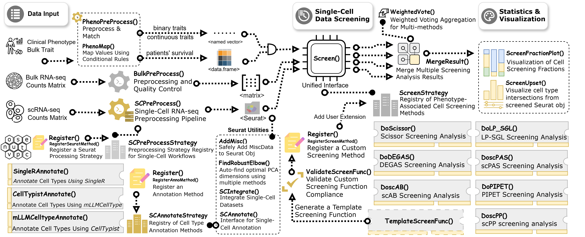

# SigBridgeR

## 🌐 Overview

SigBridgeR integrates multiple algorithms, using single-cell RNA
sequencing data, bulk expression data, and sample-related phenotypic
data, to identify the cells most closely associated with the phenotypic
data, performing as a bridge to existing tools.



## 🔧 Installation

Usually we recommend installing the latest release from GitHub because
of the latest features and bug fixes.

1.  Install the development version from GitHub:

``` r

if (!requireNamespace("pak")) {
  install.packages(
    "pak",
    repos = sprintf(
      "https://r-lib.github.io/p/pak/stable/%s/%s/%s",
      .Platform$pkgType,
      R.Version()$os,
      R.Version()$arch
    )
  )
}
pak::pkg_install("WangLabCSU/SigBridgeR")
```

2.  Install from r-universe:

``` r

install.packages("SigBridgeR", repos = "https://wanglabcsu.r-universe.dev")
```

### It is recommended to install the following packages:

`SigBridgeR` includes the Scissor and scAB algorithms by default. In
addition to these, installing the following packages allows you to use
additional algorithms.

``` r

methods <- c("scPAS", "scPP", "DEGAS", "LPSGL", "PIPET", "rSIDISH", "SCIPAC")
pak::pkg_install(file.path("Exceret", methods))
```

**unnecessary but recommended**:

For better performance:

``` r

pak::pkg_install(c(
  # faster computation
  "sparseMatrixStats",
  "matrixStats",
  "preprocessCore",
  "tidyr",
  "matrixTests",
  "KernSmooth",
  "cheapr",
  # better gene symbol conversion
  "scCustomize",
  # parallel computation
  "furrr",
  "future"
))

if (!requireNamespace("BiocManager")) {
  install.packages("BiocManager")
}
# faster computation
BiocManager::install("WGCNA")
```

For seamless integration with single-cell RNA-seq data stored in
`.h5ad`:

``` r

pak::pkg_install("anndata")
# or
pak::pkg_install("anndataR") # both are supported
```

For visualization:

``` r

pak::pkg_install(c(
 "ggplot2",
 "randomcoloR", # or RColorBrewer
 "ggupset", # for upset plot
 "patchwork", # for fraction stack plot
 "ggforce", # for pca plot
 "ggVennDiagram" # for venn diagram
))
```

To use the built-in cell annotation methods:

``` r

pak::pkg_install(c(
  # SingleR
  "SingleR-inc/SingleR",
  "celldex",
  # mLLMCelltype
  "mLLMCelltype",
  "plyr",
  # CellTypist
  "reticulate",
  "AnnDataR"
))
```

To add custom extension functions to SigBridgeR:

``` r

pak::pkg_install(c(
  "tictoc",
  "codetools",
  "knitr",
  "lintr",
  "rstudioapi",
  "yonicd/tidycheckUsage"
))
```

To reproduce the tutorial to learn more usage:

``` r

pak::pkg_install(c(
  "zeallot",
  "here",
  "org.Hs.eg.db",
  "processx"
))
```

## 📓 Documentation

Get Started:

- View [Github Webpage](https://wanglabcsu.github.io/SigBridgeR/)
- [A Quick Started
  Guide](https://wanglabcsu.github.io/sigbridger/vignettes/Quick_Start.md)
- [Start from spatial
  transcriptome](https://wanglabcsu.github.io/sigbridger/vignettes/Spatial_Transcriptome.md)
- [Full
  Tutorial](https://wanglabcsu.github.io/sigbridger/vignettes/Full_Tutorial.md)
  for more details
- Use `?SigBridgeR::function_name` to access the help documents in R.

If you encounter problems, please check:

- the [Troubleshooting
  Guide](https://wanglabcsu.github.io/sigbridger/vignettes/Troubleshooting.md),
  or
- the [Github issues](https://github.com/WangLabCSU/SigBridgeR/issues)
  page if you want to file bug reports or feature requests

Let us know if you have ideas to make this project better. Pull requests
are welcome!

## 📚 Citation

``` r

citation("SigBridgeR")
#> Please cite the following publications when using this package.
#> 
#>   Yang et al. SigBridgeR: An R Toolkit for Standardized Identification and Benchmarking of Phenotype-Associated Cell Subpopulations in Single-Cell
#>   Transcriptomics. GigaScience (2026) [SigBridgeR]
#> 
#>   Sun et al. Identifying phenotype-associated subpopulations by integrating bulk and single-cell sequencing data. Nat Biotechnol (2022) [Scissor]
#> 
#>   Johnson et al. Diagnostic Evidence GAuge of Single cells (DEGAS): a flexible deep transfer learning framework for prioritizing cells in relation
#>   to disease. Genome Med (2022) [DEGAS]
#> 
#>   Zhang et al. scAB detects multiresolution cell states with clinical significance by integrating single-cell genomics and bulk sequencing data.
#>   Nucleic Acids Res (2022) [scAB]
#> 
#>   Li et al. Identifying phenotype-associated subpopulations through LP_SGL. Brief Bioinform (2024) [LP_SGL]
#> 
#>   Gan et al. SCIPAC: quantitative estimation of cell-phenotype associations. Genome Biol (2024) [SCIPAC]
#> 
#>   Ruan et al. PIPET: predicting relevant subpopulations in single-cell data using phenotypic information from bulk data. Brief Bioinform (2024)
#>   [PIPET]
#> 
#>   Xie et al. scPAS: single-cell phenotype-associated subpopulation identifier. Brief Bioinform (2025) [scPAS]
#> 
#>   Jolasun et al. SIDISH integrates single-cell and bulk transcriptomics to identify high-risk cells and guide precision therapeutics through in
#>   silico perturbation. Nat Commun (2025) [SIDISH]
#> 
#>   He et al. Inferring Phenotypes of Single Cells Based on the Expression Profiles of Phenotype-Associated Marker Genes in Bulks and Single Cells.
#>   Interdiscip Sci (2026) [ScPP]
#> 
#>   Lin et al. TiRank prioritizes phenotypic niches in tumor microenvironment for clinical biomarker discovery. Genome Med (2026) [TiRank]
#> 
#> To see these entries in BibTeX format, use 'print(<citation>, bibtex=TRUE)', 'toBibtex(.)', or set 'options(citation.bibtex.max=999)'.
```

## 🗺️ Similar Projects

[scSurvival](https://github.com/cliffren/scSurvival): Single-cell
expression matrix (log-normalized + HVG-selected) + survival data
(optional clinical covariates and batch labels) -\> Survival-associated
cell subpopulations

[CellPhenoX](https://github.com/fanzhanglab/pyCellPhenoX): Single-cell
multi-omics data + bulk-level clinical variables, covariates (optional
interaction effect terms) -\> interpretable score per cell

[scPrognosis](https://github.com/XiaomeiLi1/scPrognosis): scRNA-seq
count matrix (imputed by MAGIC + filtered for low coverage/expression) +
bulk RNA-seq expression matrix (with matched survival time and event
status) -\> breast cancer prognostic gene signatures and Cox PH risk
prediction model

[SCellBOW](https://github.com/cellsemantics/SCellBOW): source scRNA-seq
expression matrix + target scRNA-seq expression matrix + (optional) bulk
RNA-seq expression matrix with paired survival data -\> cell embeddings,
cluster assignments, UMAP visualizations, and phenotype‑algebra‑derived
risk scores with survival probability curves for individual cell
subpopulations.

[scPER](https://github.com/BrianLlll/scPER): Single-cell RNA-seq data +
bulk RNA-seq data + celltype annotation (optional batch labels) -\>
phenotype-associated cell populations
